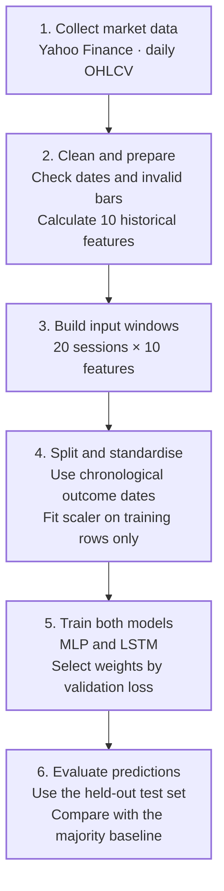
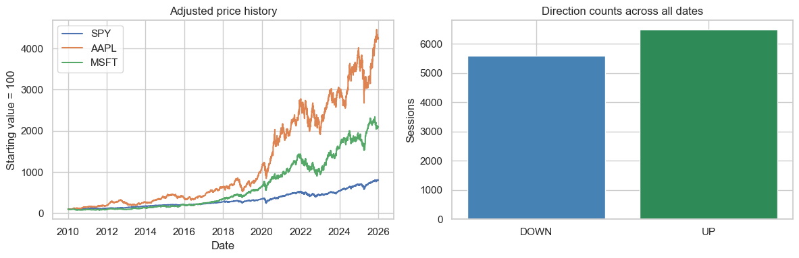
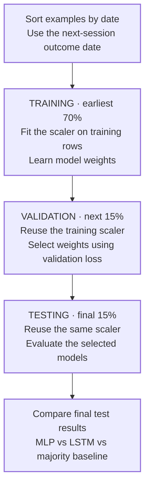
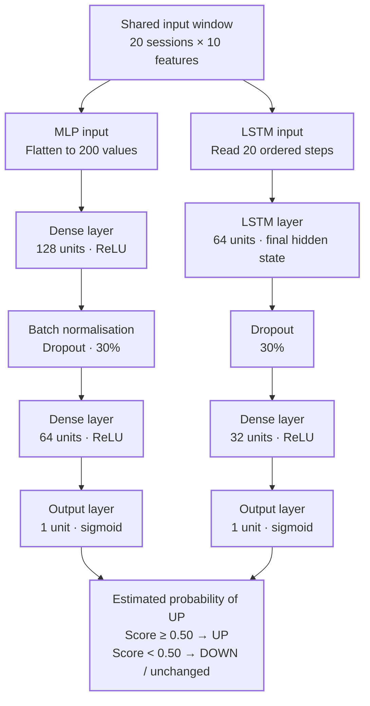
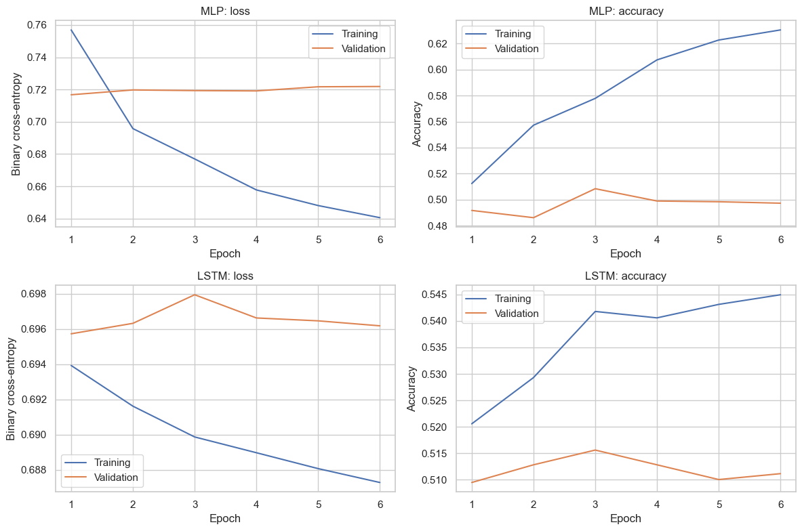
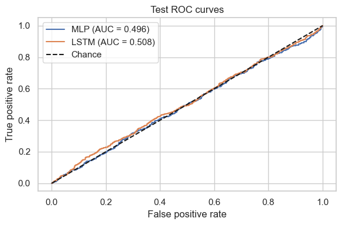
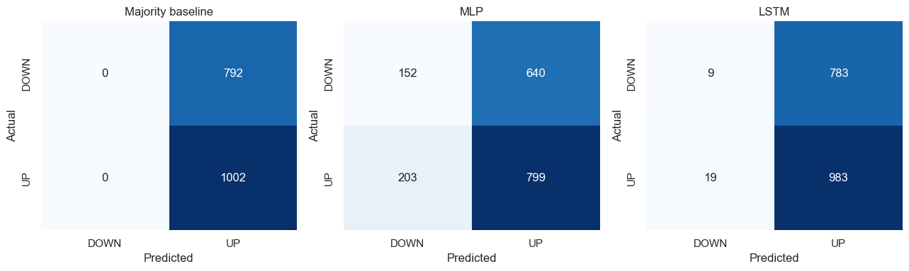

# Stock Direction Prediction: MLP vs LSTM

A learning project that compares a **Multilayer Perceptron (MLP)** and a **Long Short-Term Memory (LSTM)** network for predicting whether the next trading session's adjusted closing price will be higher than the current close.

Both models receive the same **20-session window of 10 engineered features**. The notebook implements data collection, cleaning, feature engineering, chronological splitting, standardisation, training, evaluation, and prediction from a new CSV.

**Main result:** in the notebook's saved run, LSTM achieved **55.30% test accuracy**, compared with **53.01% for MLP** and **55.85% for an always-UP baseline**. LSTM outperformed MLP, but neither neural network beat the baseline on accuracy. Their ROC-AUC values were close to 0.5, indicating weak discrimination between the two outcomes.

## Project files

| File | Purpose |
|---|---|
| [Stock_Direction_Prediction_MLP_vs_LSTM.ipynb](Stock_Direction_Prediction_MLP_vs_LSTM.ipynb) | Complete implementation, saved outputs, and evaluation charts |
| [SPY_prediction_sample.csv](SPY_prediction_sample.csv) | Separate SPY input sample for demonstrating next-session prediction |
| [MSFT_prediction_sample.csv](MSFT_prediction_sample.csv) | Separate Microsoft input sample for demonstrating next-session prediction |
| [assets/charts/](assets/charts/) | Four original charts extracted from the notebook's saved outputs |

## Problem and workflow

This is **supervised binary classification**, not exact-price forecasting. Once session `t` has closed:

- **UP = 1:** the adjusted close at `t + 1` is greater than the adjusted close at `t`.
- **DOWN / unchanged = 0:** the next adjusted close is lower or equal.

For example, a close of 100 followed by 101 produces label 1; a close of 100 followed by 99 or 100 produces label 0. The final historical row has no known next-session label and cannot be used as a labelled example.

Each model produces a sigmoid score interpreted as an estimated probability of UP. Scores **at least 0.50** are classified as UP. The scores are not expected returns, and their probability calibration has not been established.



## Dataset and source

Historical data is downloaded from **Yahoo Finance using `yfinance`**. Kaggle or Colab can run the notebook; they are not the historical data source.

| Property | Saved notebook run |
|---|---|
| Assets | SPY, AAPL, MSFT |
| Asset meanings | S&P 500 ETF, Apple stock, Microsoft stock |
| Frequency | Daily trading sessions |
| Requested period | 2010-01-01 to 2026-01-01, with the end date exclusive |
| Observed date range | 2010-01-04 through 2025-12-31 |
| Downloaded rows | 4,024 per asset, before feature-window filtering |
| Raw fields | Open, High, Low, Close, Volume |
| Price adjustment | `auto_adjust=True`, accounting for dividends and stock splits |

Examples from the three assets are pooled to train **one MLP and one LSTM**. Every individual input window stays within a single asset. Asset identity is not an extra model feature.

The two sample CSVs each contain **60 sessions from 2026-08-07 through 2026-10-30**. They are separate inference examples and are not part of the 2010–2025 train/validation/test dataset. The full historical OHLCV dataset is downloaded when the notebook runs; it is not bundled as a separate CSV.

### Historical prices and direction counts



- **Left:** dates versus adjusted closing prices rebased to 100 at the first observation. This compares relative growth across assets with different starting prices; it does not show dollar prices or prediction performance.
- **Right:** counts of valid next-session direction labels across the historical period. UP occurs more often, motivating a majority-class baseline. These descriptive counts precede supervised-window filtering and are not the final split sample counts.

Long-term price growth does not establish that individual next-session directions are predictable.

## Data preparation

1. **Clean and align observations.** Sort dates, remove duplicate timestamps, remove timezone information, and align assets to the union of their dates.
2. **Mark invalid bars.** Detect missing or infinite values, nonpositive OHLCV values, and inconsistent prices such as High below Open or Close. Invalid bars become missing values.
3. **Preserve genuine movements.** Do not fill missing prices or remove valid large price changes. Exclude windows with incomplete features or unknown targets.
4. **Calculate features.** Use only the current completed session and earlier observations; the next close supplies the label, not an input feature.
5. **Create windows.** Each example has shape `(20, 10)`, containing 200 numerical values for one asset.
6. **Split chronologically and standardise.** Fit `StandardScaler` only on training-period feature rows and reuse its statistics for validation, testing, and new CSV inputs.

### The 10 input features

Here, `C`, `O`, `H`, `L`, and `V` denote adjusted Close, Open, High, Low, and Volume; `t` is the current completed session.

| Feature | Calculation | What it describes |
|---|---|---|
| Daily return | `C_t / C_(t-1) - 1` | Current close-to-close movement |
| Previous return | Daily return shifted one session | Previous session's movement |
| Opening gap | `O_t / C_(t-1) - 1` | Opening difference from the previous close |
| Daily range | `(H_t - L_t) / C_t` | Relative intraday price spread |
| MA5 ratio | `C_t / mean(last 5 closes) - 1` | Position relative to the five-session average |
| MA10 ratio | `C_t / mean(last 10 closes) - 1` | Position relative to the ten-session average |
| MA20 ratio | `C_t / mean(last 20 closes) - 1` | Position relative to the twenty-session average |
| RSI-style momentum | `mean(gains, 14) / (mean(gains, 14) + mean(loss magnitudes, 14))` | Balance of recent gains and losses |
| Volume change | `V_t / V_(t-1) - 1` | Relative change in trading activity |
| Volatility | Rolling standard deviation of 20 daily returns | Recent variability of returns |

The RSI-style feature uses simple rolling averages and a **0–1 scale**; it is not Wilder-smoothed RSI. If average gain and loss are both zero, it is set to 0.5. Volatility is not annualised.

Standardisation uses `(value - training mean) / training standard deviation`; it does **not** constrain inputs to a 0–1 range. Rebasing prices to 100 in the chart is a separate plotting operation.

### Chronological evaluation

The split uses unique **next-session outcome dates**, with common boundaries for all assets. Training targets therefore do not extend into validation dates. Later windows may legitimately use earlier historical context.



| Split | Examples | Outcome-date boundary |
|---|---:|---|
| Training | 8,241 | Through 2021-03-29 |
| Validation | 1,794 | After training through 2023-08-14 |
| Test | 1,794 | After validation through the end of 2025 |

These are asset-session examples, not independent calendar days. The 70/15/15 ratio and 20-session lookback are practical experimental choices, not proven optima.

## Why compare MLP and LSTM?

MLP is a dense, feedforward reference model. It flattens the input matrix into 200 values. Fixed time positions remain in the vector, but the model does not carry a recurrent state.

LSTM processes 20 ordered steps, each with 10 features, updating an internal state within the window. The comparison tests whether that sequential structure helps on the same task. The LSTM is not stateful across separate input windows in this implementation.



| Model | Total parameters | Processing |
|---|---:|---|
| MLP | 34,561 | Flattened window and dense layers |
| LSTM | 21,313 | Ordered sequence and recurrent state |

These architectures differ in capacity as well as processing structure; the experiment does not isolate recurrence as the only cause of any performance difference.

## Training configuration

| Setting | Value |
|---|---|
| Framework | TensorFlow / Keras |
| Optimiser | Adam, initial learning rate 0.001 |
| Loss | Binary cross-entropy |
| Maximum epochs | 25 |
| Batch size | 128 |
| Sample shuffling | Disabled during `fit` |
| Random seed | 42 |
| Early stopping | Validation loss; patience 5; restore best weights |
| Learning-rate reduction | Halve after 2 stalled validation-loss epochs; minimum 0.00001 |

The saved run used a GPU and completed **6 epochs for each model**, restoring **epoch-one weights**, which had the lowest validation loss. A CPU is selected if a GPU is unavailable.

### Training curves



The top row shows MLP and the bottom row LSTM; blue is training and orange validation. Left panels show loss, right panels accuracy, and all horizontal axes show epochs.

MLP training accuracy rose from about **51.2% to 63.1%**, while final validation accuracy was about **49.7%**. Its falling training loss without improving validation loss suggests overfitting. LSTM's validation loss also failed to improve beyond epoch one. The panels have different vertical scales, so compare numerical values rather than apparent line steepness.

## Saved test results

**All results and charts below come from the committed notebook's saved outputs, not a new training run or a separate screenshot.** Rerunning may produce different values because execution environments, numerical behaviour, and downloaded data can differ.

The baseline assigns every example the training UP proportion, **53.67%**. At the 0.50 threshold, it always predicts UP.

| Method | Accuracy | UP precision | UP recall | UP F1 | ROC-AUC |
|---|---:|---:|---:|---:|---:|
| Majority baseline: always UP | **55.85%** | **0.5585** | **1.0000** | **0.7167** | 0.5000 |
| MLP | 53.01% | 0.5552 | 0.7974 | 0.6546 | 0.4964 |
| LSTM | 55.30% | 0.5566 | 0.9810 | 0.7103 | 0.5084 |

- **Accuracy:** fraction of all class predictions that are correct.
- **UP precision:** correct UP predictions divided by all predicted-UP examples.
- **UP recall:** correctly identified UP outcomes divided by all actual UP examples.
- **UP F1:** harmonic mean of UP precision and recall, not overall accuracy.
- **ROC-AUC:** score-ranking discrimination across thresholds; approximately 0.5 indicates weak separation.

LSTM exceeded MLP accuracy by **2.29 percentage points**, but fell **0.55 percentage points below the baseline**. The saved results do not demonstrate an accuracy advantage over the majority-class strategy or establish statistically significant forecasting skill.

### ROC curves



The horizontal axis is the false-positive rate: actual DOWN outcomes incorrectly called UP. The vertical axis is the true-positive rate, or UP recall. Each point corresponds to a decision threshold. Better curves approach the upper-left corner; the diagonal is the chance reference.

Both curves stay near the diagonal. AUC is a ranking measure, not an accuracy percentage or an estimated probability for one input.

### Confusion matrices and model analysis



Rows show actual classes and columns predicted classes. UP is positive. The diagonal contains correct predictions. Read the counts rather than comparing shading across independently scaled heatmaps.

| Method | Correct DOWN (TN) | DOWN called UP (FP) | UP called DOWN (FN) | Correct UP (TP) |
|---|---:|---:|---:|---:|
| Always UP | 0 | 792 | 0 | 1,002 |
| MLP | 152 | 640 | 203 | 799 |
| LSTM | 9 | 783 | 19 | 983 |

Every matrix totals **1,794** examples: **1,002 UP and 792 DOWN**.

- **Baseline:** catches every UP outcome but detects no DOWN outcomes. This explains its perfect UP recall.
- **MLP:** correctly identifies more DOWN outcomes than LSTM, but misses more UP outcomes and has lower overall accuracy.
- **LSTM:** correctly identifies 983 of 1,002 UP outcomes (**98.10% UP recall**) but only 9 of 792 DOWN outcomes (**1.14% DOWN recall**). It strongly favours UP.

For LSTM, precision is `983 / (983 + 783) = 55.66%`, while accuracy is `(983 + 9) / 1794 = 55.30%`. High UP recall therefore does not imply high accuracy or balanced performance across both classes.

## Run the notebook

Use a Python environment supported by your TensorFlow installation. The repository does not pin the original execution environment.

```bash
git clone https://github.com/verdhanyash/Lstm_Mlp_StockPrediction.git
cd Lstm_Mlp_StockPrediction
python -m pip install numpy pandas yfinance matplotlib seaborn tensorflow scikit-learn ipython ipywidgets jupyterlab
jupyter lab
```

Open `Stock_Direction_Prediction_MLP_vs_LSTM.ipynb` and run the cells in order. Internet access is needed to download historical data. The notebook can also be imported into Kaggle or Colab.

Saved outputs can be inspected without retraining, but they are not trained model weights. Run the training cells before invoking new-data prediction in a fresh session.

### Predict from the sample CSVs

Section 10 accepts one asset per CSV with these columns:

```csv
Date,Open,High,Low,Close,Volume
```

Provide at least **40 consecutive completed trading sessions**, with adjusted prices, unique dates, finite positive values, and consistent High/Low bars. Earlier history is needed for rolling indicators before the final 20 feature rows can be complete. Missing-weekday warnings can also reflect exchange holidays; check the input history.

In Kaggle, attach the CSV through **Add Input**. In Colab, upload it through the Files panel. Run Section 10, select a file and model, and click **Predict**. Without widgets, the cell prints results when `ipywidgets` cannot be imported.

After running the preceding cells, you can also call:

```python
predict_new_data("SPY_prediction_sample.csv", model_name="LSTM")
predict_new_data("MSFT_prediction_sample.csv", model_name="MLP")
```

The saved SPY example ends on **2026-10-30** and reports estimated UP scores of **51.42% for MLP** and **56.45% for LSTM**. Both cross the classification threshold. These single-input estimates do not replace test-set evaluation or demonstrate calibrated confidence.

## Limitations and possible extensions

- Only three US equity-related assets, including two technology stocks; limited market diversity.
- Historical price and volume features only; no news, fundamentals, or economic inputs.
- A fixed lookback, architectures, threshold, and chronological split; no exhaustive tuning or repeated walk-forward study.
- Overlapping windows and correlated assets make examples dependent, rather than independent trials.
- Market conditions can change between training and later periods.
- No probability-calibration study, significance test, or trading-profitability evaluation, including transaction costs.

Future work could add simpler learned baselines, broader assets, validation-based tuning, repeated walk-forward evaluation, and uncertainty analysis before considering any trading application.

## References

- [yfinance documentation](https://ranaroussi.github.io/yfinance/) — historical market-data retrieval.
- [Keras documentation](https://keras.io/) — neural-network implementation and training.
- [scikit-learn documentation](https://scikit-learn.org/stable/) — standardisation and classification metrics.

## Learning-purpose disclaimer

**This project is for learning and educational purposes only. It is not intended for real-world stock prediction, investment decisions, or live trading. Its outputs are experimental model estimates, not financial advice or reliable forecasts.**
